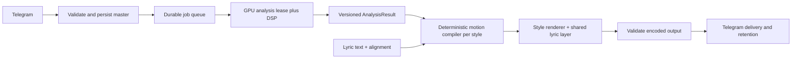

# Music Visualizer Pivot Plan — Final Version

**Final version, 15 October 2026. Replaces the 9 October draft.** Pivot this repository into one Telegram music visualizer for heavy, rhythmically complex music (Tool- and Meshuggah-style material: odd meters, polymeter, down-tuned guitars). The bot analyzes an uploaded track, obtains genuine instrument stems and measured musical events, and renders a video in which every visible element shows one physical property of the sound: pitch, timbre, attack, decay, or meter. The sphere stays. Three new styles replace the three incomplete ones. Every style supports an optional Persian lyric video.

This is a plan, not an implementation. No measured quality, latency, or cost advantage is claimed for the proposed changes. Physical mappings below are design intent and must pass the checks in section 12 before they are called correct.

## Decisions fixed in this version

| # | Decision | Consequence |
|---|---|---|
| 1 | Keep the sphere as the "energy and emotion" style. Retire Iris, Neural Synapse, and Monolith Field. They are replaced, not repaired. | No repair work on the old three. They are hidden now and removed after their replacements qualify (section 10). |
| 2 | Add three new styles: **Polymeter Orrery**, **Cymatic Plate**, **Resonant Bodies**. | Preset IDs `orrery`, `cymatic`, `bodies`. Section 6. |
| 3 | One rule for every style: each visual element maps to one measurable physical property of the sound. No generic "bars and glow". | A style may not ship a mapping it cannot test in isolation. |
| 4 | Persian lyrics are a first-class option in every style: off, subtitles, or full lyric video. | One shared lyric layer, not per-style text code. Section 7. |
| 5 | Audio-to-picture sync is a measured release criterion. | Analysis and DSP fixes come before any style work. Sections 2 and 5. |
| 6 | Real stems, and honest "unknown" when evidence is missing. | A style hides or simplifies a layer instead of faking it. |
| 7 | The bot interface is English only. Only the lyrics and the music are Persian. | Translate the existing Persian button and status text to English. Lyrics and lyric previews stay Persian. |
| 8 | Keep the server music analyzer (the "music DNA" broker). It works: 31 of 31 logged runs succeeded in about 8–14 seconds. Do not edit its files by hand on the server. | Keep the transport. Build the richer analysis in this repository and treat the broker's output as the cheap baseline. Section 5. |
| 9 | GPU testing is approved, with cost kept small. | One throwaway container, one 45-second clip, a stated spending cap, no change to the deployed app. Phase 3. |

## Implementation status — 11 October 2026

The first reliability slice is implemented locally and remains uncommitted. This is **partial Phase 1**, not completion of the pivot.

- GPU lookup targets the configured instance exactly. API errors are distinguished from an empty account; unrelated instances are not used as substitutes.
- Startup/admission and shutdown share a lock. Manual stop cannot interrupt an active lease; cancelled shutdown retains admission until the transition finishes.
- Replacement creation and setup are checked. A ready replacement is promoted only after tunnel readiness; the warm instance is retained and stopped as standby. Destruction is limited to replacements created by this manager.
- `AudioIntelligenceAdapter.prepare_visualizer_audio` keeps separation, stem downloads, vocal transcription, and the master-audio retry inside one enclosing lease. Optional transcription failure preserves stems.
- `transcribe_lyrics_managed` leases standalone transcription and waits for its synchronous request. Forced alignment also obtains a lease. Synchronous transcription errors propagate instead of returning `None`.
- The stop button reports an unconfirmed stop rather than always claiming success.

Observed checks: 24 new offline GPU/workflow regression tests passed; 11 existing feature/manifest/alignment tests passed with external analysis mocked; three existing deterministic music checks passed. No live GPU, Telegram, deployment, or billing action was performed. Run the new regressions from the repository root:

```sh
python3 -m unittest discover -s tests -p '*gpu*.py'
```

## Implementation status — 16 October 2026

Implemented on branch `feat/pivot-analysis-and-styles` (from `origin/main`), **uncommitted and not pushed**. Nothing is deployed and no GPU was used: the Modal client is not installed here and the owner declined installing it.

| Plan item | State |
|---|---|
| Phase 1: English interface, retired styles hidden, CI runs the new tests | Done. Styles are offered only if listed in `AUDIOVIZ_ENABLED_STYLES` (default `sphere`). |
| Phase 2: native-rate band levels, no smoothing in analysis, levels that never anticipate a sound, shared silence floor, no invented rhythm | Done and tested. **Not done:** versioned/persisted analysis artifacts, and the audio-video offset calibration clip. |
| Phase 3: hit classes (kick, snare, cymbal), meter estimate, riff cycle, pitched notes (YIN), per-stem spectral bands | Done with numpy and ffmpeg only; all are candidates that need fixture review. **Not done:** a real multi-stem model and Beat This!, which need the GPU test (section 11, Phase 3). |
| Phase 4: sphere v2 | Bass now peaks within 3 frames (was 4+), hits come from classified onsets, treble shows as brightness, intensity zero also disables beat pulses. The sphere has **not** been moved onto the shared scene helper. |
| Phase 5: durable jobs | **Not started.** |
| Phase 6: Persian lyric layer | Done: off, subtitles, lyric video; word fill; offset command; bundled Vazirmatn. Aligning pasted lyrics already existed. |
| Phases 7–9: Orrery, Cymatic Plate, Resonant Bodies | Built, rendered and inspected as stills from `Manic-sample.mp3`, and hidden by default until reviewed as encoded video. |
| Phase 10: delete the three old style files | **Not done on purpose.** They are no longer reachable from the runtime, Root, validator, or bot, but the files remain for the separate retirement change. |
| Phase 11: optional planner | Not started (parked). |

Observed checks: type check clean; 46 renderer tests (motion 8, Orrery 10, Cymatic 7, Bodies 8, lyrics 8, contract 5) and 68 Python tests passed. The end-to-end manifest test passed only with the GPU and broker seams mocked. The real sample's features were accepted by the renderer's validator for all four styles. Not verified: encoded video, audio-video sync in the final file, Telegram delivery, real stems, the server broker's output on this clip, and any GPU timing.

## 1. Product and release criteria

The journey is upload → validation → queued analysis → style and lyric-mode choice → queued render → video delivery. One persisted analysis supports every later style choice without separating the track again. Output stays 1920×1080 at 30 FPS. Bot copy must match the real output. Square output follows only after framing and delivery are verified. 30 FPS gives 33 ms picture resolution; 60 FPS is considered only after render cost is measured.

Create a small fixture collection before tuning: licensed or user-owned excerpts that include Persian singing, another vocal language, instrumental heavy music with odd meter, down-tuned guitar and bass, sharp percussion, sparse rests, a section change, and a tempo or meter change. Record license, clip boundaries, SHA256, and retention rules. Synthetic tones and supplied isolated stems give exact timing references. Model-separated real songs need listening review because separation leaks.

| Release requirement | Observable acceptance |
|---|---|
| Genuine stems | Normal quality provides separate vocals, drums, bass, and other outputs (guitar too if the six-output model qualifies), with checkpoint and version evidence. Two-output results are labeled as such. Filtered master bands are never called "separated drums". |
| Independent response | Solo and mute each stem with everything else fixed. Its intended motion changes and its captured image region changes. Unrelated channels stay stable except documented global composition effects. |
| Synchronization | A synthetic event causes no driven response before its master-clock time and begins within one output frame after it. Verify at the start, middle, and end of the encoded clip. |
| Musical honesty | Missing meter, downbeats, pitch, riff cycle, or key stays unknown. A style hides that layer instead of inventing it. Low-confidence rhythm cannot flash in silence. |
| Physical mapping | For each style, an isolated test changes one input (for example one note, one kick, one meter) and shows the one expected visual change. |
| Persian lyric video | Word highlight begins within one frame of the aligned word start. Letter joins stay intact. Mixed Persian, Latin, and digits render correctly. Lines stay inside the safe area. Section 7. |
| Render reliability | Frame 0, later frames, backward seeks, independent browser starts, and repeated frames all show visible geometry with no shader or context errors. Same environment and inputs reproduce the same frame. |
| Durable jobs | Duplicate callbacks cannot duplicate expensive work. Restart, cancellation, failed replacement, and delivery retry preserve recoverable artifacts and resource ownership. |
| Visible quality | Review calm, vocal, drum, bass, and transition passages for readable roles, stable silhouette, restrained exposure, safe lyrics, and no clipping or flicker. Inspect the final H.264 file and Telegram delivery. |
| Operational budget | Measure cold and warm analysis, render time, memory, storage, and actual charges on the deployed GPU. Set limits from those measurements. |

These are completion conditions. A passing byte-difference test proves response, not attractive motion or good separation.

## 2. Demonstrated defects to repair first

The dedicated runner installs only the audioviz router, builds a data manifest, and renders fixed Three.js components. It does not call the old LLM art director. Older runners still expose voice, music, and edit features, so those files are outside this product path but not globally unused.

| Priority | Finding | Implication |
|---|---|---|
| P1: stems | **Source fact:** both GPU paths load only `vocals_mel_band_roformer.ckpt`, and the service maps outputs to `vocals` and `instrumental` only ([vast_ai_service.py](../vast_ai_service.py), [modal_gpu_app.py](../modal_gpu_app.py)). Bass and drum curves are filtered copies of the full mix ([audio_features.py](../bot/services/audio_features.py)). The sphere cannot tell the difference because those curves are always filled in. | Add a genuine multi-stem model. Mark missing stems as missing. |
| P1: DSP | **Measured:** every band is resampled to 3 kHz before the level is computed. A 6 kHz tone read 5.4 instead of about 13,050; 10 kHz read 2.7 instead of about 13,900; 3 kHz read 95.6 instead of about 12,400. Treble and cymbals are almost erased, and "drums" keep mostly kick. The earlier audit measured the same loss (8 kHz burst treble mean 0.00029 against 0.99731 for a 1 kHz mid). | Compute levels at the native sample rate, then reduce time resolution. |
| P1: sync | **Measured** with 60 Hz synthetic kicks, no stems, 30 FPS: kick detection lands on the exact frame; extraction curves peak 1 frame later; sphere drums peak 2 frames later; sphere bass (the largest motion) peaks 4 frames (about 133 ms) later, reaching half its peak after 1 frame. Smoothing is applied twice: once in extraction, once by the sphere spring. | Remove extraction smoothing. The motion compiler owns attack and release. |
| P1: rhythm | **Observed on the server (read-only, 15 October):** the music DNA broker is healthy: 31 of 31 logged runs succeeded, each in about 8–14 seconds. But its script (`/opt/audioviz-broker/bin/run_groove.py`, outside this repository and outside CI/CD) is a plain librosa beat tracker: one global tempo, **downbeats are simply every fourth beat**, and the key falls back to "C Major" on any error. That is wrong for odd meters. The bot also falls back to the same invented values if the broker times out or the folder is missing ([audio_adapter.py](../bot/services/audio_adapter.py)). | Keep the broker as the baseline. Mark its downbeats "assumed 4/4". Add meter-aware beats beside it. Remove the invented fallbacks. |
| P1: capture | **Observed (earlier audit):** all nine raw Iris/Neural/Monolith captures were fully transparent. Only the sphere waits for its scene before the first frame. | The three old styles are retired. Every new style uses the sphere's readiness pattern. |
| P1: infrastructure | **Mocked reproductions:** lease ends before ASR; failed replacement destroys the warm instance; shutdown races admission; a missing target selects an unrelated instance. | Partly fixed (status above). Finish and test. |
| P1: verification | **Source fact:** CI appends `\|\| echo` to Python tests, hiding failure. | Propagate failures. |
| P2: loudness | **Reasoned, not measured:** each curve is scaled by its own maximum, which leaves little contrast on very loud, compressed masters. | Use a shared reference level and noise floor. Test on fixtures. |
| P2: lyrics | **Source fact:** the overlay shows whole lines only and shows each line exactly when its first word starts ([TypographyOverlay.tsx](../renderer/src/components/TypographyOverlay.tsx)). Word timings already exist in the manifest but are unused. Fonts load from the internet during render ([fonts.css](../renderer/src/fonts.css)). | Section 7. |
| P2: data | **Observed:** ASR confidence 0.07 became 1.0. Job cache is memory-only; callbacks are unguarded. | Typed results and durable jobs (section 8). |

Evidence sits in the [audio audit](../research_notes/Telegram%20music%20visualizer%20audit/audio_pipeline.md), [observed checks](../research_notes/Telegram%20music%20visualizer%20audit/audio_pipeline_checks.md), and [visualizer audit](../research_notes/Telegram%20music%20visualizer%20audit/visualizers.md). The October 15 sync and band measurements used throwaway scripts; Phase 2 turns them into permanent tests.

## 3. Keep the target architecture small

Keep one bot, the existing GPU analysis service, and the existing render service. Start with SQLite job metadata and per-job artifact directories, one active GPU workload across analysis and rendering, and bounded queues. No Redis, no microservices, no generic plugin engine.



| Owner | Responsibility |
|---|---|
| `bot/routers/audioviz.py` | Telegram input, ownership, style and lyric choices, status, cancellation, delivery. No DSP, GPU lifecycle, or shader mapping. |
| New `bot/services/jobs.py` | SQLite transactions, state transitions, idempotency, leases, retries, retention. |
| `audio_adapter.py`, `vast_lifecycle.py` | Typed analysis transport and exact GPU ownership. |
| `vast_ai_service.py`, `modal_gpu_app.py` | Pinned model loading, real capability report, separation, alignment, optional ASR, beat inference. |
| `audio_features.py` | Native-rate decoding and acoustic features. Split `analyze_audio` from `compile_manifest`; choosing a style never reruns analysis. |
| `contracts/` and `renderer/src/types/` | Python and TypeScript schemas, validated at every trust boundary. |
| Renderer | One motion compiler per style, one shared lyric layer, one shared scene lifecycle. No inference or GPU provisioning during a frame render. |

Dependency direction: Telegram → orchestration → analysis contracts → motion compiler → render.

## 4. Persist versioned analysis contracts

Add `contracts/analysis.py` with TypeScript counterparts. Persist analysis before showing styles. Large curves are immutable referenced artifacts (ID, hash, length, unit, time base); the metadata does not copy thousands of values.

The shape describes capability honestly. A stem is `separated`, `estimated`, `missing`, or `silent`. A filtered master band is `estimated` and is stored under its own name, never as a separated stem. No stem receives invented confidence.

```json
{
  "schemaVersion": 1,
  "analysisHash": "sha256-of-canonical-analysis",
  "master": {"sha256": "...", "sampleRateHz": 44100, "sampleCount": 1323000},
  "pipeline": {"version": "analysis-v1", "models": [{"id": "...", "checkpointSha256": "..."}]},
  "capabilities": {"availableOutputs": ["vocals", "drums", "bass", "other"], "independentStems": true},
  "stems": {"drums": {"status": "separated", "offsetSamples": 0, "offsetEvidence": "measured"}},
  "envelopes": {"bass": {"hopSamples": 441, "windowSamples": 882, "windowConvention": "trailing", "unit": "linear-rms"}},
  "events": {
    "onsets": [{"sample": 44100, "stem": "drums", "strength": 0.8, "band": "low"}],
    "notes": [{"startSample": 44100, "endSample": 66150, "pitchHz": 55.0, "stem": "bass", "confidence": 0.7}]
  },
  "rhythm": {"status": "measured", "beats": [], "downbeats": [], "meter": {"value": "7/8", "confidence": 0.6}},
  "cycle": {"status": "unknown", "lengthSteps": null, "stepSamples": null},
  "key": {"status": "unknown"},
  "lyrics": {"status": "disabled", "words": []},
  "warnings": []
}
```

Rules that carry over unchanged:

- Authoritative timestamps are integer samples on the decoded master clock. `masterSample = alignedStemSample + offsetSamples`; measure the offset or mark it unverified.
- A trailing envelope value at time `s` covers `[max(0, s − window), s)`. Sample onset-sensitive channels causally so interpolation cannot anticipate a hit.
- Frame count is `ceil(sampleCount × fpsNumerator / (sampleRateHz × fpsDenominator))`. An event first appears at the earliest frame whose time reaches its sample.
- Cache analysis by source and decoded hashes, pipeline version, model hashes, and settings. Cache render output by analysis hash, style, seed, renderer version, size, FPS, and encoder. A changed palette invalidates only the render.
- Unknown schema versions fail clearly. Legacy v1 curves can render through an adapter but never count as genuine multi-stem evidence.

## 5. Build the analysis the styles need

Each new style needs specific evidence (section 6). All of it is produced here, once, and stored.

**Decode and bands.** Validate the downloaded media: byte limit, decodable container, finite non-silent audio, channels, duration. Decode once at native 44.1 or 48 kHz. Compute RMS and spectra at the native rate, then reduce to a 100 Hz envelope grid (a candidate to benchmark). Keep band edges in the metadata. Add a shared reference level and noise floor so very quiet leakage is not amplified to full influence. Down-tuned guitar and bass overlap at about 40–100 Hz, so low-band design must be tested on the fixtures, not assumed.

**No smoothing in analysis.** Store raw physical envelopes. Attack and release belong to each style's motion compiler. Remove the alpha smoothing in `audio_features.py`.

**Stems.** Evaluate `htdemucs` (vocals, drums, bass, other) and `htdemucs_6s` (adds guitar and piano) through the existing audio-separator wrapper. Guitar is the main reason to test the six-output model for metal. Check model documentation for known weaknesses of the guitar and piano outputs. `htdemucs_ft` adds substantial work and must justify itself on the fixtures. Keep the current vocal model only as an optional refinement if listening or ASR results justify a second pass. Pin versions and checkpoint hashes; check code and weight licenses, VRAM, GPU placement, startup, and peak memory before choosing defaults. After separation, verify every declared output exists, decodes, matches the time base, and passes hash verification. Reject malformed output instead of searching arbitrary paths. Test delay with known mixtures. These are candidates, not tested winners.

**Hit detection.** From each stem compute an onset-strength curve (spectral flux is the first candidate) and explicit onset events with strength. For the drums stem, classify each onset by its spectral content into kick, snare, and cymbal classes. Loudness alone does not give hit times. Classification quality is unmeasured and needs fixture review.

**Note events.** Run a note detector (Spotify's Basic Pitch is a candidate; check its license, VRAM, and accuracy) on bass and vocals, and on the other or guitar stem where the sound is clean enough. Heavy distortion makes pitch unreliable, so mark such notes low-confidence or unknown. Amplitude alone is not melody.

**Rhythm.** Keep the existing music DNA broker: it is reliable, free (server CPU, no GPU cost), and already wired in. Its output stays the baseline for tempo, a rough beat grid, and key. Change only the client side in this repository:

- Record the broker's downbeats as `assumed 4/4`, never as measured, and its key as `estimated`.
- Report the broker's absence or timeout as `unknown`, not as 120 BPM and C Major.
- Do not edit the script on the host by hand. Changing it is outside CI/CD, so it is the owner's deployment decision, and the plan does not depend on it.

Add the meter-aware part beside it, produced in this repository: evaluate Beat This! (inspected v1.1.0, revision `ad7974846029835307ba19a3d5cefbf40b243041`) for beats and downbeats, derive meter from downbeat spacing in beats, and keep its confidence. Run it inside the GPU lease that already holds the stem job (no extra cold start) unless a CPU run proves fast enough. Compare it against the broker's grid on the fixtures: where they agree, confidence rises; where they disagree, the style shows the measured result or hides the layer. A beat tracker does not by itself prove bar phase. Benchmark on pickups, tempo changes, sparse music, and odd meter; unknown is a valid result.

**Riff cycle.** From guitar or bass onsets quantized to the beat subdivision, search for a repeating pattern length by autocorrelation, and report its length in steps with a confidence. If no stable cycle exists, report unknown. The Polymeter Orrery needs this. Accuracy on real Tool and Meshuggah material is unproven; fixture annotation decides it.

**Key and sections.** Keep chroma-based key and repeated-section boundaries as optional low-priority evidence. Allow "ambiguous" for modal Persian material. Do not name verse or chorus without evaluation.

**One GPU lease.** Run separation, beat inference, note detection, alignment, and optional ASR in one orchestration lease. Persist and download outputs before release. CPU DSP runs locally off the async event loop. Never hold the GPU while a person chooses a style.

## 6. The visualizer lineup

Four styles ship, all driven by the same analysis and all with the same lyric layer. The rule for every style: each visual element answers to one physical property, and a missing input removes the element instead of faking it.

| Style | ID | What it shows | Main evidence |
|---|---|---|---|
| Particle Sphere (kept) | `sphere` | Energy and emotion: mass, flow, shock | bass, drums, vocals, other, beats |
| **Polymeter Orrery** | `orrery` | Rhythm structure and polymeter | onsets, beats, downbeats, meter, riff cycle |
| **Cymatic Plate** | `cymatic` | Pitch and harmony | note events, onsets |
| **Resonant Bodies** | `bodies` | Timbre, attack, decay per instrument | per-stem spectra, onsets, release times |

### Shared rules

- **Compile in order, sample any frame.** Like `compileSphereMotion`, each style integrates its motion once in timeline order, then reads any frame independently. This keeps seeks and parallel Chromium workers identical.
- **Shared scene lifecycle.** One small helper (`useThreeScene`) allocates the canvas with explicit size, builds seeded geometry, waits for assets and fonts, updates uniforms for the requested frame, draws, then releases the render blocker. It disposes everything on every exit and handles shader and context failure. The sphere's current readiness pattern is the foundation. Never draw in React's render body.
- **Lyric hooks.** Each style declares a lyric-safe region and may read word-onset events from the shared lyric layer (section 7).
- **Evidence gating.** A style declares the stems and events it needs. If an input is missing, the style hides that layer. Example: no riff cycle means no riff ring.
- **Performance.** Particle and mesh counts are starting guesses. Benchmark on the target GPU before and after changing them.

### Particle Sphere (kept)

Keep identity and the ordered-integration compiler. Pass the manifest seed and validated parameters through `AudiovizRuntime`. Fix the inputs and sync (sections 2 and 5), then give each stem its own role:

| Evidence | Sphere motion owner | Guard |
|---|---|---|
| Bass envelope | Broad radial pressure with spring recoil | Responds from the event frame. Sustained notes deform continuously; release recoils within bounded displacement. |
| Drum onsets | Traveling surface waves and ember accents | Event age advances after the hit; strength sets gain; a refractory period prevents duplicate shocks. |
| Vocals | Directional flow and twist | Fast attack, slower release, never rewinds. A silent vocal stem stays neutral. |
| Other (and guitar) | Secondary folds and texture | Independent of vocals. |
| Treble | Visible brightness and opacity, not only point size | Point-size clamps currently erase treble; fix. |
| Beats and downbeats | Small accents; phrase-level emphasis | Only from confident beats; no flashes in silence. |

Expose attack and release in milliseconds, spring damping, gain, and idle motion through one bounded parameter schema. "Intensity zero" disables every driven effect, including beat pulses. Existing values (for example vocal 25 ms attack, 120 ms release) are starting points.

### Polymeter Orrery (`orrery`)

**Idea.** Concentric rings that make rhythmic structure visible. The outer ring is the bar. An inner ring is the guitar and bass riff cycle. Because the two lengths differ, the riff slides against the bar and realigns only after the common length. Odd meters appear as the segment layout of the bar ring.

**Mapping.**
- Bar ring: one revolution per bar, with segments equal to the beats of the detected meter. A beat ring sits inside it.
- Riff ring: one revolution per detected cycle length (for example 23 sixteenth notes).
- Ring angle comes from beat positions, not from constant wall-clock speed, so tempo changes move the rings correctly.
- Each onset stamps a mark on its ring at its true position: kick as a deep radial notch, snare as a bright cut, cymbals as a fine scratch. Strength sets size. Marks fade at the stem's measured release time.
- Realignment points (where bar and riff phases coincide) get a quiet marker.

**Fallbacks.** No stable cycle: hide the riff ring. Meter unknown: show the beat ring only. Beats unknown: show only the onset marks around a free-running ring, labeled as unsynced in the bot message.

**Lyric hook.** Lyrics sit in the central clear disc. The current word's onset adds a thin pulse to the inner edge.

**Acceptance.** A synthetic 7/8 click track shows seven bar segments. A 4-beat bar against a 5-step cycle drifts and realigns at 20 steps. Removing the drums stem removes the kick and snare marks and nothing else.

### Cymatic Plate (`cymatic`)

**Idea.** A vibrating plate covered in sand. Sand collects on the still lines (nodal lines) of whatever vibration pattern the sound excites, as in Chladni's experiments. Notes choose the pattern, chords overlay patterns, and hits throw the sand up before it settles.

**Mapping.**
- Use the idealized square free-plate pattern `z(x, y) = cos(nπx)·cos(mπy) − cos(mπx)·cos(nπy)` on the unit square. Sand rests where `z = 0`. This is a standard idealization, not a model of a specific physical plate.
- A design table maps a note's pitch to a mode pair `(n, m)`: higher pitch gives a higher mode order, so low down-tuned notes make a few large cells and high notes make a fine lattice. The table is a design choice and must be documented and tested for monotonic behavior.
- Chords superpose mode patterns weighted by note strength. Consonant intervals tend to give symmetric patterns; dissonant clusters look broken. Check this against fixtures; do not assume it.
- A kick or snare applies an agitation that throws sand off the lines and decays at the measured release time.
- Grains hold no stored state: in the vertex shader each grain moves from its rest position toward the nearest nodal line by a fixed number of descent steps on `|z|`, with agitation added from hit age. Any frame, seek, or worker gives the same picture. This shader approach is a prototype to evaluate; the step count controls the look.

**Fallbacks.** No reliable note events: the plate stays still and reacts only to hits. Distorted guitar with unknown pitch drives agitation only. Never invent notes.

**Lyric hook.** Lyrics sit in the lower third, outside the plate. Word onsets add a faint ripple.

**Acceptance.** A single sine at one pitch gives one stable pattern; changing the pitch changes the pattern; two pitches give the superposition; silence settles the sand.

### Resonant Bodies (`bodies`)

**Idea.** Show each instrument as the kind of object that makes the sound, vibrating with that instrument's own spectrum and decay.

**Mapping.**
- One body per available stem. Bass is a heavy string, guitar a taut string, drums a drum skin plus a metal disc for cymbals, and vocals a column of air whose width follows loudness and whose texture follows brightness.
- Each body's shape is a sum of vibration modes. Version 1 takes mode amplitudes from about 16 log-spaced spectral bands of that stem (roughly 30 Hz to 16 kHz). Bright, distorted sound makes a jagged body; clean sound makes a smooth one.
- Damping time follows the stem's measured release, so a long sustain looks long.
- An onset injects an impulse (a pluck or strike) sized by onset strength.
- Pitch-aligned harmonics are a later upgrade, only if pitch tracking proves reliable.

**Fallbacks.** A missing stem means that body is not drawn. Master-mix copies never stand in for a stem.

**Lyric hook.** The vocal body sits center-left; lyrics sit below it.

**Acceptance.** Muting a stem removes exactly its body. A clean tone and a distorted tone at one pitch give visibly different body shapes. A struck body decays at about the stem's measured release time.

### Parked ideas

Phase Portrait (an oscilloscope view locked to the bass note, with timbre as shape) and Harmonic Strata (a terrain with one axis in notes and one layer per stem) may follow after the three styles ship.

## 7. Persian lyric video, available in every style

**Modes.** `off`, `subtitles` (current behavior: lines near the bottom), and `lyric video` (lyrics lead and the style leaves room for them and reacts to word onsets). The bot offers the mode alongside the style choice.

**Getting good timing.**
1. Best path: the user pastes the real lyrics. They are force-aligned to the vocal stem using the existing alignment service (`/ai/align` and the Persian model) and the existing `realign_transcript` helper.
2. Fallback: speech recognition on the vocal stem, with confidence kept as measured (the 0.07 → 1.0 defect fixed).
3. Corrections: keep the existing edit-text flow and add an "offset all lyrics ±N ms" command and a per-line nudge.
4. Words flagged interpolated or with low alignment confidence fall back to line-level highlighting instead of fake word precision.

**Text rules.**
- Normalize ASR and pasted text: Arabic yeh and kaf to Persian forms, consistent digits, and zero-width non-joiner kept where it is meaningful. Reuse the helpers in `normalizer.py` and add tests.
- Render each word as one element so Persian letters join correctly. Never split a word into per-letter elements.
- Keep Latin words and digits in isolated left-to-right runs, as `PersianText.tsx` already does.
- Right-to-left layout: at most two lines, inside the style's declared safe area.

**Timing behavior.**
- Show a line about 300–500 ms before its first word is sung so it can be read. This is a starting value to tune.
- During the line, fill the current word from right to left across its width, driven by the aligned word start and end.
- Keep the last line briefly after it ends. Fade older lines.
- A word's onset is published as an event that styles may read (section 6 hooks).

**Fonts.** Bundle Vazirmatn with the renderer (confirm its license text before bundling) and wait for it to load before the first frame. No network font loading during render.

**Acceptance.** Word fill begins within one frame of the aligned word start. Joined letters stay joined (inspect crops). Mixed Persian, Latin, and digits render in the right order. Two-line limit holds on long phrases. A 10-minute song produces no overlapping or missing lines. Lyrics-off output has no text.

## 8. Make jobs recoverable and the bot understandable

- **Identity.** UUID job ID plus bot, user, chat, and message identity. The upload idempotency key includes bot ID, chat ID, message ID, and file identity; the render key adds analysis hash, style, lyric mode, and output settings. Authenticate callback ownership. A double tap returns the existing status.
- **States.** `received`, `validating`, `queued_analysis`, `analyzing`, `ready`, `queued_render`, `rendering`, `delivering`, `done`, `failed`, `cancelled`, with `cancel_requested` as a flag until workers acknowledge. Record attempts, stage errors, timestamps, artifact hashes, model versions, progress, lease owner and expiry, and delivery IDs. SQLite transactions claim work and check the expected state; heartbeats extend leases.
- **One status message** with the real stage, queue position when known, and measured progress. Offer lyric mode (off, subtitles, lyric video), paste lyrics, offset, retry, cancel, and "render another style" from retained analysis. Explain degraded analysis plainly, for example: "Only vocals and accompaniment were available, so instrument-specific visuals are limited."
- **Style menu.** The sphere is the default. A new style appears only after it qualifies. The three retired buttons are removed from the menu in Phase 1, because their captures are blank. Do not claim billing stopped.
- **GPU admission.** One active GPU workload in total across analysis and rendering when they share an instance. Both queues claim the same persisted lease, identified by the exact GPU or instance ID. Release it while the user chooses a style. FIFO across eligible phases; record enqueue and eligible times.
- **Limits.** Maximum upload bytes, decoded duration and channels, queue length, per-user pending jobs, stage timeouts, disk use, and retention come from measured resources. Remotion's two Chromium workers are not an admission limit; `/render` currently accepts concurrent requests ([server.ts](../renderer/server.ts)).
- **Recovery.** On restart, reconcile expired leases with worker state. Reuse verified analysis; resume delivery from a finished video; retry an interrupted stage only if its output was not committed. Keep an outbox record for uncertain delivery and do not claim exactly-once delivery without a receipt. Bound retries.
- **Cancellation.** Queued work is removed transactionally. Active work receives cancellation, stops subprocesses and browser tasks, confirms termination, then releases leases. Cleanup never deletes live worker input. TTL cleanup only touches unleased job-owned directories.

## 9. Harden service boundaries and GPU ownership

- Authenticate bot-to-renderer and renderer-to-analysis calls. "Local" is not authentication.
- Replace the caller-chosen `/upload?path=` with server-created asset IDs inside a fixed job root. Validate job and stem IDs, resolved paths, size, container, hash, and ownership. Reject traversal, escaping symlinks, arbitrary URLs, and cross-job reads. Apply the same rules to analysis uploads and downloads.
- Validate the manifest before rendering: version, duration, exact array lengths, ordered bounds, finite values, parameter ranges, and allowed local assets. Replace broad AI proxying with the specific authenticated routes needed. Revisit disabled web security and ignored certificate errors once local assets work.
- Never place bot, billing, storage, or model credentials in render props, logs, artifacts, or browser bundles.
- GPU lifecycle is serialized `stopped → starting → ready → busy → stopping` with an owned instance ID and generation token. A completed stop cannot overlap an active lease. A missing configured ID is reported missing, never replaced by another instance. Promote a replacement only after readiness, tunnel, and model checks. Test two sequential jobs after failover.
- Provisioning, replacement, model downloads, and any LLM call need an approved spending policy, bounded attempts, and timeouts. Without that approval, fail with a recoverable status rather than buying capacity.

## 10. Retire the old styles and legacy paths deliberately

| Item | Action | Condition |
|---|---|---|
| `QuantumIrisVisualizer.tsx`, `NeuralSynapseVisualizer.tsx`, `MonolithFieldVisualizer.tsx` | Hide the bot buttons in Phase 1. Delete in the retirement phase. | Do not repair. Delete only after at least two replacement styles qualify. |
| Preset IDs `iris`, `neural`, `monolith` | Remove from `VisualizerPresetId` in [manifest.py](../contracts/manifest.py), [manifest.ts](../renderer/src/types/manifest.ts), and [render_contract.ts](../renderer/render_contract.ts). Add `orrery`, `cymatic`, `bodies`. | Old stored jobs get a clear "style retired, choose another" message with a re-render option. |
| `Root.tsx` compositions `QuantumIrisViz`, `NeuralSynapseViz`, `MonolithFieldViz` | Replace with the new styles' compositions. | After the new styles qualify. |
| [VISUALIZER_GOALS.md](../references/VISUALIZER_GOALS.md) and the three reference JPEGs | Move to a history folder and mark superseded. Replace with a goals file for the new styles. | Do not blanket-delete. |
| Shared assets: `TapeStrip.tsx`, `fonts.css`, required fonts | Move to shared primitives or keep. | The lyric layer still uses them. |
| `contracts/__init__.py` exports from `creative_spec.py` | Test import boundaries, then remove the coupling. | Package initialization currently reaches CreativeSpec. |
| Older entry points and services: `bot_run.py`, `bot/main.py`, `bot/routers/{voice,music,edit}.py`, `bot/services/{director,music_director,asset_engine,spatial_director,type_engine,environment_engine,audit,transcriber}.py` | Deprecate, then remove after checking deployed entry points and external callers. | Separate reviewed change. |
| Legacy render branches (`Composition.tsx`, `SwissRuntime.tsx`, `VoitomoSwiss` and `VoiceMotion` server branches) | Return a clear deprecation error, then remove. | Inspect external clients first. |
| ASR GPU, broker, and local branches; `gpu_start_services.sh` and `setup_gpu.sh` startup | Consolidate to one supported path each. | After deployment inventory. |
| Historical tests, README claims, `docs/decisions/ADR-0007*` to `ADR-0009*` | Review and update current guidance; keep useful history. | Do not delete by directory name. |

## 11. Implement in ordered, reviewable phases

Each phase ends with artifacts, observed tests, and a rollback point. Do not delete legacy code before its replacement is verified. Flags named here are proposed gates, not configuration performed by this plan.

**Phase 0 — freeze evidence and fixtures.** Record deployed revisions, environment and model hashes, hardware, and GPU ownership policy. The music DNA broker is confirmed to exist and work (section 2). First fixture: `Manic-sample.mp3` (45.3 s, 48 kHz stereo, MP3), kept in the `yue2-music-engine` repository under `samples/clips/` and **not** copied into this one (MP3 files are git-ignored here). Record its SHA256 and rights in the fixture manifest. Preserve the user's uncommitted diff. Store the fixture manifest and safe baseline clips outside existing outputs. Done: a developer can reproduce the baseline without live spending. Rollback: none needed; production is unchanged.

**Phase 1 — finish lifecycle and verification; hide the retired styles.** Touch `vast_lifecycle.py`, `audio_adapter.py`, router lease boundaries, `ci.yml`, and `tests/test_gpu_lifecycle.py`. Turn the five mocked failures into regression tests. Fix the ASR confidence contract with a 0.07 regression. Make Python failures fail CI. Remove the iris, neural, and monolith buttons from the style menu. Translate every Persian button, status, and error message in the bot to English; lyric previews and the lyrics themselves stay Persian. Done: failed create preserves the warm instance; overlapping admission waits safely; two post-failover jobs succeed in mocks; the menu shows only the sphere. Rollback: pause GPU admission and automatic failover.

**Phase 2 — correct DSP and sync; introduce contracts.** Add the analysis schema and split analysis from manifest compilation in `audio_features.py`. First write tests that reproduce the tone-band loss (100 Hz, 1 kHz, 3 kHz, 6 kHz, 8 kHz, 10 kHz), kick latency, unknown rhythm, and length mismatches. Then decode at native rate, compute bands before reducing time resolution, remove analysis smoothing, add the shared reference level, remove the invented rhythm and key fallbacks, and persist analysis atomically. Add an audio-video offset calibration clip so encoding latency can be measured and corrected. Done: band tests pass; a kick produces a response that begins within one output frame; style changes reuse one analysis hash. Rollback: stop v2 writes and use the tested conservative v1 adapter.

**Phase 3 — qualify stems and musical evidence.** Touch `vast_ai_service.py`, `modal_gpu_app.py`, `audio_adapter.py`, and analysis tests. Add explicit capability reporting and the multi-stem model adapter. Add onset events with kick, snare, and cymbal classes, note events, beats and downbeats with meter, and riff-cycle detection one at a time. Confirm licenses and memory. Keep the music DNA broker as the baseline and add the meter-aware beats beside it (section 5). **GPU test budget:** run the first model comparison in one throwaway Modal container, never in the deployed app. Use a T4 (0.59 USD per hour in [gpu_cost.py](../bot/services/gpu_cost.py), plus CPU and memory, about 0.85 USD per hour in total by that file's rates; verify at modal.com/pricing). Process only the 45-second sample. Load every candidate (both Demucs variants, Beat This!, the note detector) in the same run so there is a single cold start, then stop the container. A ten-minute run is about 0.14 USD by those rates. Cap the first experiment at 0.25 USD; stop and report if a step would exceed it. Later fixtures reuse the downloaded results and run only what the first run showed is worth running. Done: the fixture songs have listened-to independent stems, annotated rhythm comparisons, honest unknowns, and measured resource and cost records. Rollback: restore the previous pinned adapter with its true two-output capability; never label proxies as stems.

**Phase 4 — sphere v2 and the shared scene lifecycle.** Touch `sphereMotion.ts`, `ParticleSphereVisualizer.tsx`, `AudiovizRuntime.tsx`, and a new `useThreeScene.ts`. Add one stem role at a time: bass response from the event frame, drum event age, independent vocal flow, other folds, visible treble. Propagate seed and parameters. Done: solo and mute cases, silence and intensity-zero, out-of-order and repeated frames, first draw, context failure, and disposal checks pass; the bass response begins within one frame of the event; reviewed encoded clips keep the sphere's identity. Rollback: route to the retained tested sphere.

**Phase 5 — durable Telegram operation.** Add `jobs.py` and migrations; simplify `audioviz.py`; add render admission, idempotency, status, and cancel contracts in `server.ts`; apply the section 9 boundaries. Test duplicate uploads and callbacks, queue fullness, restart at every stage, delivery retry, worker death, and cancellation. Done: one analysis and one render per identity, bounded resources, recoverable failure, accurate UI; then an authorized short Telegram smoke test. Rollback: pause intake and keep SQLite state and artifacts.

**Phase 6 — Persian lyric layer.** Build the shared lyric layer (section 7): modes, pasted-lyrics alignment, offset commands, word fill, local font bundling, word-onset events. Replace the line-only overlay. Done: the section 7 acceptance checks pass in the sphere. Rollback: keep the current line overlay.

**Phase 7 — Polymeter Orrery.** It needs only onsets, beats, downbeats, meter, and the riff cycle, so it can start as soon as Phase 3 delivers them. Build the compiler, the scene, and its fallbacks. Done: the section 6 acceptance checks pass on synthetic and fixture clips, with lyric-video mode working. Rollback: hide the style.

**Phase 8 — Cymatic Plate.** Needs note events. Prototype the shader approach first and decide the step count by visual review. Done: acceptance checks pass; a recorded comparison against fixture notes confirms the pitch-to-pattern table behaves monotonically. Rollback: hide the style.

**Phase 9 — Resonant Bodies.** Needs per-stem spectra and release times. Done: acceptance checks pass; mute tests remove exactly the muted body. Rollback: hide the style.

**Phase 10 — retire the old styles and legacy code.** Follow section 10 in a separate change after at least two new styles qualify and external callers are inventoried. Rollback: restore from the retirement snapshot.

**Phase 11 — optional creative planning (parked).** Only after the sphere and at least two new styles are qualified. A strict, validated JSON plan may choose palette and section emphasis within fixed capability limits; the rule-based plan stays as fallback, and generated source code never runs in production. It would need an offline comparison against the fixed renderer, with blind review, declared repair budgets, isolation for any generated code, and actual measured cost. No LLM is planned for the core path.

Migration rules: add schema-version readers before writers, migrate SQLite transactionally with a backup, keep immutable old artifacts during the rollback window, and stop accepting unsupported new work rather than resetting state.

## 12. Verify public outcomes and measure actual budgets

| Test group | Required cases |
|---|---|
| Decode and bands | Valid formats; corrupt, empty, and truncated files; duration and size limits; sustained tones at 100 Hz, 1 kHz, 3 kHz, 6 kHz, 8 kHz, 10 kHz; broadband; silence. Assert retained high energy and correct band selectivity. |
| Sync | Synthetic kicks and clicks at known times. Assert no response before the event and a response beginning within one frame after. Check start, middle, and end of the encoded video, and compare audio against picture using the calibration clip. |
| Stems and timeline | Supplied multi-stem mixtures; two-output capability; missing versus silent; unequal sample rate or length; positive and negative offsets; hash mismatch. |
| Events and rhythm | Pickup bars, tempo changes, odd meters (7/8, 5/4), ambiguous meter, repeated sections, riff cycles of known length (for example 23 steps), no-cycle material, instrumental and sung. Score annotated onset, beat, and downbeat timing separately. Unknown is valid. |
| Motion | Solo and mute each stem; impulsive and sustained inputs; onset causality; release continuity; monotonic flow; missing evidence; silence with beat metadata; intensity zero. |
| Style mappings | For each new style, the isolated tests in section 6 (7/8 click track; single sine and two-sine chord; muted stem). |
| Lyrics | Persian-only, mixed Persian/Latin/digits, long lines, instrumental gaps, low-confidence words, pasted lyrics with and without an offset, lyrics off. Inspect crops for joined letters. |
| Render | Frame 0 and the last frame; independent starts; repeat, backward, and random seeks; one and two workers; seeded geometry; font readiness; shader and context loss; final codec, compression, clipping, and AV sync. |
| Jobs and lifecycle | Double taps, cross-user callbacks, concurrent requests, full queue, shutdown during admission, failed create, missing instance, two jobs after failover, cancellation, restart, uncertain delivery, TTL while leased. |
| Security | Unauthenticated calls, traversal and symlinks, arbitrary URLs, oversized or non-finite manifests, unknown versions, cross-job access. Reject before costly work. |
| Perception and operations | Blinded review of appearance, musical connection, and glitches on fixtures; measured cold and warm GPU, CPU, RAM, disk, and render throughput; actual billed usage. |

Reuse `tests/test_audio_features.py`, `tests/test_end_to_end_manifest.py`, `tests/test_alignment_regressions.py`, `renderer/test_sphere_motion.ts`, and `renderer/test_sphere_render.ts`. Add behavioral cases before each fix. Offline tests mock provisioning, HTTP, SSH, and broker seams; the current manifest tests are live-capable, so do not run them unmodified as a harmless suite. CI runs the focused Python tests, TypeScript checking, motion tests, and isolated Chromium captures, with failures propagated. Live GPU and Telegram checks stay opt-in.

Record onset delay in samples, frames, and milliseconds, plus event precision and recall with a documented tolerance. Camera movement can confound image-difference metrics, so pair motion logs with region-level capture checks and human review. First determinism target: same-environment repeated frames are equal. Benchmark before reducing particle counts or adding post-processing. Store hardware, GL, browser, and package versions with results.

## 13. Decisions still to close with evidence

Closed by the owner on 16 October: English-only interface; keep the music DNA broker; first fixture is `Manic-sample.mp3`; GPU testing is approved at small cost (section 11, Phase 3).

Still open, and settled by measurement:

- Four-output or six-output separation, chosen on fixture listening and memory.
- Whether Beat This! adds enough over the broker's beats to justify its run time (compare on the fixtures).
- Whether note detection is reliable enough on down-tuned bass and distorted guitar for the Cymatic Plate (if not, it relies on bass, vocals, and clean passages only).
- Whether 60 FPS is worth its render cost.
- Deployed entry point and revision; exact GPU, model, and checkpoint versions; VRAM headroom; render hardware (read-only server inspection).
- Fixture rights and retention for songs beyond the first sample.

Developer completion checklist:

- Freeze fixtures, the uncommitted changes, baseline clips, and deployment facts.
- Fix lifecycle, confidence, DSP, and sync defects before changing artistic strength.
- Persist versioned analysis with honest stem capability, sample clocks, hashes, and uncertainty.
- Qualify one multi-stem and beat pipeline on the real hardware.
- Release the sphere with encoded-sync evidence.
- Complete durable queue, cancel, recovery, authentication, and retention, with an authorized Telegram smoke test.
- Ship the shared Persian lyric layer.
- Qualify and ship each new style behind its own gate.
- Retire the three old styles and legacy code in a separate reviewed change.

**Validation available today:** 14 safe Python tests passed (six feature/manifest checks with external analysis mocked, three music checks, five alignment regressions), six sphere motion tests, and renderer TypeScript checking. Local sphere captures responded to bass, vocals, and drums and repeated identically; isolated treble did not. All nine raw captures of the old non-sphere styles were transparent. On 15 October, throwaway probes with synthetic tones and kicks measured the band loss and the latency figures in section 2. On 16 October the same band loss was confirmed on the real `Manic-sample.mp3`: after the 3 kHz resample the treble band keeps 14.7% of its energy and its shape correlates only 0.37 with the native-rate treble; mids keep 84.8% (correlation 0.94); bass is unaffected. A rough numpy tempo estimate on the clip gave 152 BPM in all three thirds, with weaker candidates at about 99 and 76 BPM, so the tempo looks steady but its meter is not yet known. These observations support the repair order. They do not prove real-song stem quality, deployed performance, final Telegram output, or the new styles' appearance.

This revision changed only this document. It installed no packages, changed no source or configuration, contacted no live service, and made no deployment or billing claim. The previous draft is backed up in the session scratch folder.
